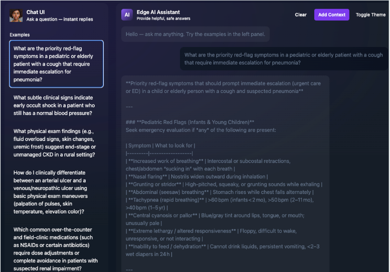
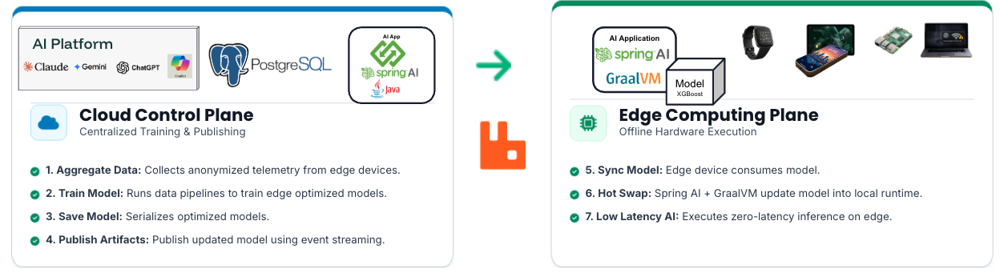

# Achieving Low-Latency AI Data with Edge Computing

A healthcare-themed reference demo showing how to keep AI **fast and available at the edge** (for example, a rural clinic with limited connectivity). The idea is to train in the core, then ship the models and knowledge to the edge. The edge runs inference locally with no round trip to a central service or a hosted LLM.





## Architecture





The demo shows various low latency edge AI patterns:

| Pattern | What it does | Where it runs                                                        |
|---|---|----------------------------------------------------------------------|
| **Generative AI (RAG)** | Answers clinical questions with a local LLM, grounded in clinical documents and cached for repeat questions | Local Ollama plus a Valkey vector store and cache (`assistance-app`) |
| **Semantic Caching** | Integrated Vector DB caching delivers instant query responses. | Edge/Cloud                                                           |


### Why this is low latency

- **Inference is local.** The AI model runs in-process (ex: XGBoost4J). Scoring one patient using small language model predictions, with no network call.
- **The LLM is local.** Ollama serves the model on the edge node. No cloud API is involved.
- **Retrieval and caching are in memory.** Valkey/Postgres holds the vector index and the cache, so repeated questions are served from cache instead of re-running the LLM.
- **Training stays off the edge.** Data arrives over a stream, is stored and trained in PostgresML, and only the resulting model artifact moves to the edge.

## Repository layout

| Path | Purpose |
|---|---|
| [components/domains](components/domains) | Shared domain model (`SepsisVitalHistory`, `SepsisInferenceFeatures`) |
| [applications/integration/data-integration-app](applications/integration/data-integration-app) | Consumes sepsis vitals from a RabbitMQ stream and persists them as the training source |
| [applications/ai-data-edge-computing](applications/ai-data-edge-computing) | Training and model publishing with PostgresML. `PostgresMLModelService` reads a trained XGBoost model out of `pgml.*`. SQL for the sepsis and CKD examples is under `src/test/resources/sql` |
| [applications/edge/sepsis-edge-app](applications/edge/sepsis-edge-app) | Edge inference service. `SepsisDetectionService` returns a sepsis probability from vitals |
| [applications/edge/assistance-app](applications/edge/assistance-app) | Clinical assistant web UI (Spring AI, Ollama, Valkey vector store and cache) |
| [deployments/local](deployments/local) | Podman start scripts for Ollama, PostgresML, RabbitMQ and Valkey |
| [docs](docs) | Clinical knowledge base used for RAG (sepsis, pneumonia/bronchitis, CKD, foot ulcers) and the conference deck |

## Prerequisites

- Java 21
- [Podman](https://podman.io/) (or Docker)
- On macOS, `brew install libomp`, which XGBoost4J needs
- Enough disk and RAM for the Ollama model configured in the assistance app (`gpt-oss:20b` by default)

## Run it locally

All commands run from the repo root. The Gradle build is multi-project (see [settings.gradle](settings.gradle)).

**1. Start the infrastructure**

```shell
./deployments/local/ollama/start-ollama.sh        # LLM runtime        :11434
./deployments/local/valkey/start-valkey.sh        # vector store/cache :6379
./deployments/local/postgresml/start.sh           # training DB        :5433
./deployments/local/rabbitmq/start.sh             # vitals stream      :5672 / :15672
```

[start-tanzu.sh](deployments/local/rabbitmq/start-tanzu.sh) starts Tanzu RabbitMQ instead and needs access to the Broadcom registry.

**2. Training**

1. Prompt an AI assistant to generate the SQL schema and sample data (see [docs/SEPESIS.md](docs/SEPESIS.md)).
2. Build the domain (`components:domains`).
3. Start the data pipeline source and sink (`data-integration-app` consumes `sepsis.vitals.queue` into PostgreSQL).
4. Train in PostgresML with `pgml.train(...)`, using `algorithm => 'xgboost'`. See [sepsis_train.sql](applications/ai-data-edge-computing/src/test/resources/sql/sepsis_train.sql) and [ckd_sql_ddl.sql](applications/ai-data-edge-computing/src/test/resources/sql/ckd_sql_ddl.sql).
5. Publish the model. `PostgresMLModelService.loadXGBoostModel(projectName)` loads the latest model for a project.

**3. Edge inference**

```shell
./gradlew :applications:edge:sepsis-edge-app:bootRun
```

Send the service patient vitals and it returns a probability between 0.0 and 1.0. Example input:

```json
{
  "heartRate": 115.5,
  "systolicBp": 88.0,
  "diastolicBp": 54.0,
  "meanArterialPressure": 65.3,
  "respiratoryRate": 24.0,
  "spo2": 93.5,
  "temperature": 38.6,
  "wbcCount": 14.8,
  "lactate": 3.2
}
```

**4. Clinical assistant (RAG)**

```shell
./gradlew :applications:edge:assistance-app:bootRun
```

Open http://localhost:8088. Sample prompts come from `app.ai.prompts` in [application.yaml](applications/edge/assistance-app/src/main/resources/application.yaml). The app exposes these endpoints:

| Endpoint | Purpose |
|---|---|
| `POST /vector/search` | Ask a question |
| `POST /vector/search/prompt/context` | Add context to the vector store |
| `POST /vector/search/similarities` | Show similar stored documents |
| `DELETE /vector/search/prompt` | Remove a stored prompt |
| `GET /prompts` | List the sample prompts |
| `DELETE /cache/ops` | Clear the cache |

## Example RAG question

**Question**

```text
What are the priority red-flag symptoms in a pediatric or elderly patient with a cough that require immediate escalation for pneumonia?
```

**Context** (retrieved from [docs/bronchitis and pneumonia.md](docs/bronchitis%20and%20pneumonia.md))

- *Pediatric:* retractions, nasal flaring, grunting, tachypnea (>60/min under 2 months, >50/min 2–11 months, >40/min 1–5 years), cyanosis, lethargy, inability to feed.
- *Elderly (65+):* acute confusion, hypothermia, silent hypoxia (SpO2 <92%), new falls, worsening of chronic conditions.
- *All ages:* cyanosis, severe pleuritic chest pain, hemoptysis, hemodynamic instability.

## Tech stack

Spring Boot 4, Spring AI, Spring Integration, Ollama, Valkey, PostgresML, XGBoost4J, RabbitMQ (stream queue), Gradle, Podman.

## Disclaimer

This is a demonstration only. The sample data, models and clinical text are not validated for real clinical use and are not medical advice.

## License

See [LICENSE](LICENSE).
